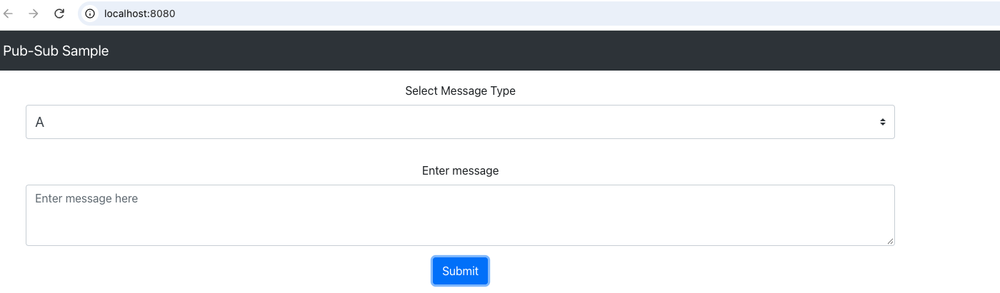

# Dapr pub/sub with ActiveMQ Artemis

A small demo of [Dapr pub/sub](https://docs.dapr.io/developing-applications/building-blocks/pubsub/) running on [Apache ActiveMQ Artemis](https://activemq.apache.org/components/artemis/). It's based on the Dapr [pub-sub tutorial](https://github.com/dapr/quickstarts/tree/master/tutorials/pub-sub). The apps are unchanged. Only the broker is different.

Dapr talks to Artemis through its AMQP 1.0 component, `pubsub.amqp`. You'll find it in [`components/pubsub.yaml`](./components/pubsub.yaml).

## What's inside

| App | Role | Topics |
|---|---|---|
| `react-form` | Publisher (web form) | A, B or C |
| `node-subscriber` | Subscriber | A, B |
| `python-subscriber` | Subscriber | A, C |

## Prerequisites

- [Dapr CLI](https://docs.dapr.io/getting-started/install-dapr-cli/), runtime 1.19 or later (`dapr init`)
- [Docker](https://docs.docker.com/get-docker/)
- Node.js, plus [uv](https://docs.astral.sh/uv/) for Python. 

## Run it

The log lines under each step come from a test run on Dapr 1.19.0. Your output will have more lines. These are the ones to look for.

1. Start Artemis.

```bash
docker run -d -p 5672:5672 -p 8161:8161 --env ARTEMIS_USER=artemis --env ARTEMIS_PASSWORD=artemis --name artemis apache/activemq-artemis:latest
```

It prints a container ID. Give it a moment to start before the next step.

2. Start the Node subscriber.

```bash
cd node-subscriber
npm install
dapr run --app-id node-subscriber --resources-path ../components --app-port 3000 node app.js
```

Look for

```text
Component loaded: pubsub (pubsub.amqp/v1)
app is subscribed to the following topics: [[A B]] through pubsub=pubsub
Attempting to subscribe to multicast://A
Attempting to subscribe to multicast://B
✅  You're up and running! Both Dapr and your app logs will appear here.
```

3. In a new terminal, start the Python subscriber.

```bash
cd python-subscriber
uv sync
dapr run --app-id python-subscriber --resources-path ../components --app-port 5001 uv run python app.py
```

Look for

```text
Component loaded: pubsub (pubsub.amqp/v1)
app is subscribed to the following topics: [[A C]] through pubsub=pubsub
Attempting to subscribe to multicast://A
Attempting to subscribe to multicast://C
✅  You're up and running! Both Dapr and your app logs will appear here.
```

4. In a new terminal, publish one message to each topic from the repo root.

```bash
dapr publish --publish-app-id node-subscriber --pubsub pubsub --topic A --data-file message_a.json
dapr publish --publish-app-id node-subscriber --pubsub pubsub --topic B --data-file message_b.json
dapr publish --publish-app-id node-subscriber --pubsub pubsub --topic C --data-file message_c.json
```

Each one prints

```text
✅  Event published successfully
```

The Node subscriber gets A and B.

```text
A:  Message on A
B:  Message on B
```

The Python subscriber gets A and C.

```text
Received message "Message on A" on topic "A"
Received message "Message on C" on topic "C"
```

5. Or publish from the web form instead. Start it and open http://localhost:8080.

```bash
cd react-form
npm run buildclient
npm install
dapr run --app-id react-form --resources-path ../components --app-port 8080 npm run start
```

The build can take a minute. Look for

```text
Component loaded: pubsub (pubsub.amqp/v1)
Listening on port 8080!
✅  You're up and running! Both Dapr and your app logs will appear here.
```

Open http://localhost:8080. You should see this form.



Pick a message type, enter some text and submit. The React terminal logs the publish.

```text
Publishing:  { messageType: 'A', message: 'message A' }
```

## Clean up

Stop each app with Ctrl+C, then remove the broker.

```bash
docker rm -f artemis
```

## License

Apache 2.0, same as the original [dapr/quickstarts](https://github.com/dapr/quickstarts) repo. See [LICENSE](./LICENSE).
